

<strong>Decision Loom — collapse to hide motion</strong>

<a href="https://aman-kumar-ai-portfolio.vercel.app">
  <picture>
    <source media="(max-width: 640px) and (prefers-reduced-motion: reduce)" srcset="./assets/identity-signal-mobile-still.png">
    <source media="(max-width: 640px)" srcset="./assets/identity-signal-mobile.png">
    <source media="(prefers-reduced-motion: reduce)" srcset="./assets/identity-signal-still.png">
    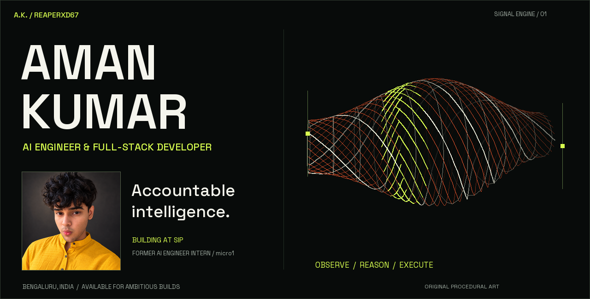
  </picture>
</a>

[**Explore the portfolio →**](https://aman-kumar-ai-portfolio.vercel.app) · [**Recruiter quick read**](https://aman-kumar-ai-portfolio.vercel.app/?view=recruiter) · [**One-page ATS résumé · PDF**](https://aman-kumar-ai-portfolio.vercel.app/profile/aman-kumar-resume.pdf)

<strong>AI Engineer & Full-Stack Developer</strong> · SIP Project Lead Developer Intern · Former micro1 AI Engineer Intern · Bengaluru

[LinkedIn](https://www.linkedin.com/in/aman-kumar-494601329) · [Email](mailto:amankumr3254u@gmail.com) · [X / Twitter](https://x.com/Aman1181)

## Systems you can inspect.

Three flagship builds. Real interfaces, visible boundaries, source behind every decision.

<strong>Autonomous Personal Agent · architecture film · collapse to hide motion</strong>

<picture>
  <source media="(max-width: 640px) and (prefers-reduced-motion: reduce)" srcset="./assets/showcase-agent-mobile-still.svg">
  <source media="(max-width: 640px)" srcset="./assets/showcase-agent-mobile.svg">
  <source media="(prefers-reduced-motion: reduce)" srcset="./assets/showcase-agent-still.svg">
  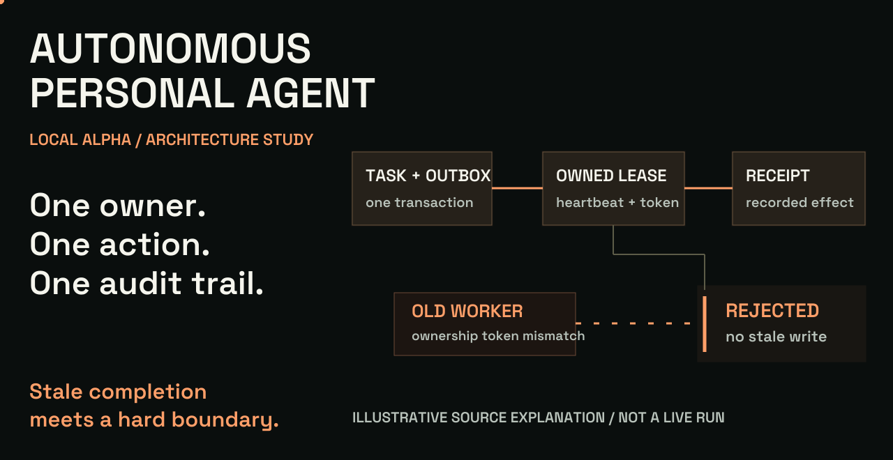
</picture>

**[Autonomous Personal Agent](https://github.com/ReaperXD67/autonomous-personal-agent) · Local alpha.** Owned leases, bounded retries and durable receipts make interrupted work recoverable.

[Source](https://github.com/ReaperXD67/autonomous-personal-agent) · [Why stale workers stop](https://github.com/ReaperXD67/autonomous-personal-agent/blob/main/docs/decisions/ADR-0007-durable-execution-lifecycle.md) · [Approval + receipt implementation](https://github.com/ReaperXD67/autonomous-personal-agent/blob/main/services/control-api/app/action_store.py) · [CI](https://github.com/ReaperXD67/autonomous-personal-agent/actions/workflows/ci.yml)

Agent engineering, stack & honest scope

Python / FastAPI / PostgreSQL / Redis / Docker. Task, outbox and audit state share a transaction. Owned leases, heartbeats, bounded retries and dead letters recover interrupted work. Exact-action digests bind reviewed content to execution; receipts protect recorded side effects from replay.

Private single-operator dashboard, career workflows and isolated adapters. Career Play can authorize bounded applications within an explicit, expiring scope; manually prepared actions retain exact-action review. External application proof remains pending. The isolated ATS adapter is verified against a local fixture. [Current capability status](https://github.com/ReaperXD67/autonomous-personal-agent#implemented-now) · [Exact-action design](https://github.com/ReaperXD67/autonomous-personal-agent/blob/main/docs/decisions/ADR-0010-exact-external-actions.md) · [MIT license](https://github.com/ReaperXD67/autonomous-personal-agent/blob/main/LICENSE).

<strong>AtlasLM · product + retrieval film · collapse to hide motion</strong>

<picture>
  <source media="(max-width: 640px) and (prefers-reduced-motion: reduce)" srcset="./assets/showcase-atlaslm-mobile-still.svg">
  <source media="(max-width: 640px)" srcset="./assets/showcase-atlaslm-mobile.svg">
  <source media="(prefers-reduced-motion: reduce)" srcset="./assets/showcase-atlaslm-still.svg">
  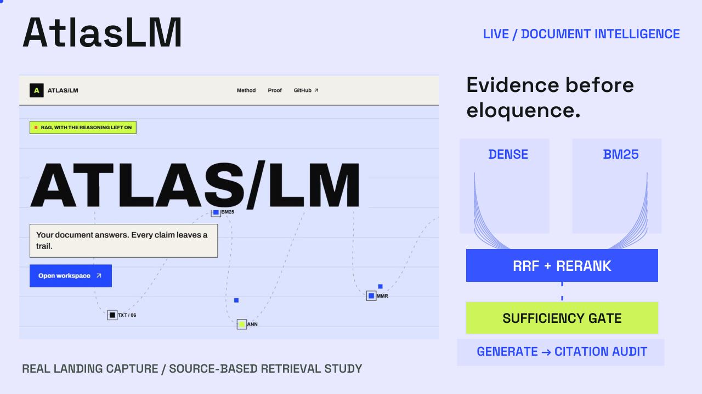
</picture>

**[AtlasLM](https://github.com/ReaperXD67/notebooklm-rag) · Live.** Hybrid retrieval and evidence gates keep generated answers inspectable; weak evidence can stop an answer.

[Open workspace](https://notebooklm-rag-five.vercel.app/workspace) · [Source](https://github.com/ReaperXD67/notebooklm-rag) · [Retrieval architecture](https://github.com/ReaperXD67/notebooklm-rag/blob/main/docs/RAG_ARCHITECTURE.md) · [Quality gates](https://github.com/ReaperXD67/notebooklm-rag/actions/workflows/quality.yml)

AtlasLM engineering, stack & honest scope

Next.js / TypeScript / Qdrant / Upstash Vector / OpenRouter. Deterministic ingestion, dense + BM25 retrieval, reciprocal-rank fusion, reranking and MMR diversity. Answers expose source passages, citation checks, confidence signals and timed execution traces.

One source workspace at a time. The semantic cache is instance-local; multiple instances would need shared cache state. Qdrant serves the local path and Upstash Vector the serverless deployment. [Architecture and honest scope](https://github.com/ReaperXD67/notebooklm-rag#honest-scope).

<strong>MinePulse / KarixMC · product + trust-boundary film · collapse to hide motion</strong>

<picture>
  <source media="(max-width: 640px) and (prefers-reduced-motion: reduce)" srcset="./assets/showcase-karixmc-mobile-still.svg">
  <source media="(max-width: 640px)" srcset="./assets/showcase-karixmc-mobile.svg">
  <source media="(prefers-reduced-motion: reduce)" srcset="./assets/showcase-karixmc-still.svg">
  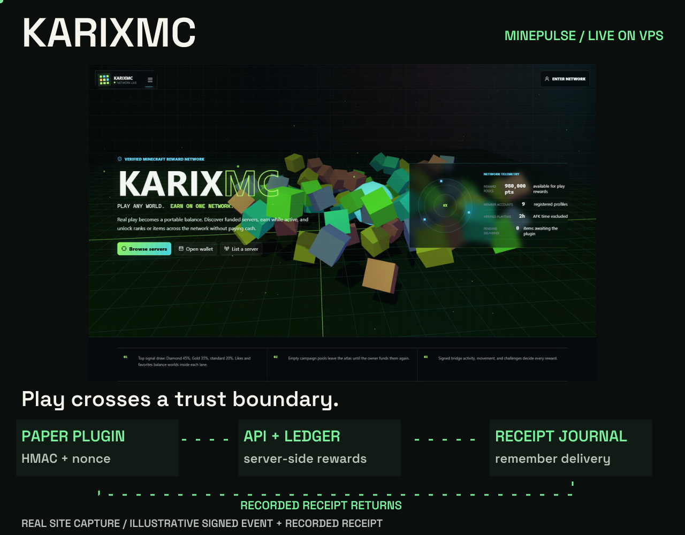
</picture>

**[MinePulse / KarixMC](https://github.com/ReaperXD67/MinePulse) · Live on VPS.** Signed game events, server-side rewards and recorded delivery receipts connect play to the web.

[Explore KarixMC](https://karixmc.pl) · [Source](https://github.com/ReaperXD67/MinePulse) · [Paper plugin](https://karixmc.pl/plugin) · [Security boundary](https://github.com/ReaperXD67/MinePulse/blob/main/SECURITY.md) · [Production runbook](https://github.com/ReaperXD67/MinePulse/blob/main/PRODUCTION_RUNBOOK.md)

KarixMC engineering, stack & honest scope

Next.js / Java / Paper / PostgreSQL / Redis / Nginx. Verified playtime, reward ledgers, server stores and a Paper plugin. HMAC-signed events cross the game/API boundary; expiring purchase claims and a plugin-side receipt journal handle acknowledgements. Remembering delivered commands makes recovery safer when an acknowledgement is lost.

Two application replicas behind Nginx, PostgreSQL, Redis and recurring encrypted backups. Campaign-credit purchases are manually confirmed; automated payment checkout is not connected. Deployment is not a claim of customer scale. [Current implementation](https://github.com/ReaperXD67/MinePulse#plugin-api).

Compare the three architectures

<picture>
  <source media="(max-width: 640px)" srcset="./assets/architecture-atlas-mobile.svg">
  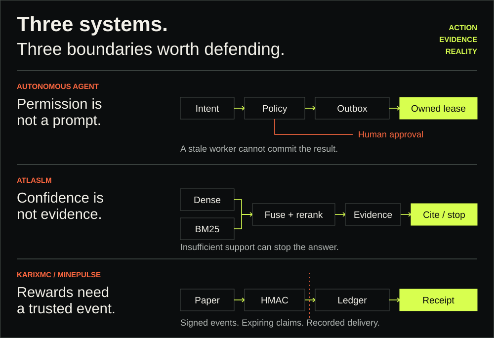
</picture>

## More engineering, different constraints.

<strong>Explore the build index · collapse to hide motion</strong>

<picture>
  <source media="(max-width: 640px) and (prefers-reduced-motion: reduce)" srcset="./assets/showcase-build-index-mobile-still.svg">
  <source media="(max-width: 640px)" srcset="./assets/showcase-build-index-mobile.svg">
  <source media="(prefers-reduced-motion: reduce)" srcset="./assets/showcase-build-index-still.svg">
  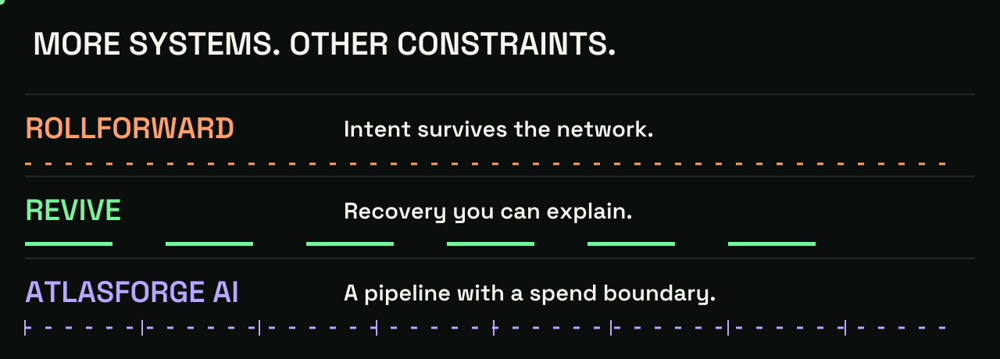
</picture>

[**ROLLFORWARD → live**](https://rollforward-engine.onrender.com) · [decisions](https://github.com/ReaperXD67/rollforward-optimistic-engine/blob/main/DECISIONS.md) 
[**Revive → live**](https://revive-revenue.vercel.app) · [source](https://github.com/ReaperXD67/revive-ai) 
[**AtlasForge AI → source**](https://github.com/ReaperXD67/atlasforge-ai) · [architecture](https://github.com/ReaperXD67/atlasforge-ai/blob/main/ARCHITECTURE.md)

Secondary systems, constraints & lower-level explorations

- **ROLLFORWARD:** separate projected state from confirmed truth; preserve intent in IndexedDB, retry with the same idempotency key and expose `412` conflicts.
- **Revive:** live payment-recovery prototype with deterministic policies, HMAC-verified webhooks and immutable audit records. Its challenge exercises the hosted backend; payment outcomes are demo data, not real charges or measured merchant uplift.
- **AtlasForge AI:** checkpointed video production with provider fallbacks, editorial gates and bounded cloud spend. SQLite and filesystem artifacts deliberately serve one workstation.
- [GPT Prototype](https://github.com/ReaperXD67/GPT-Prototype): a decoder-only transformer built from first principles with RoPE, RMSNorm, QK-Norm and Muon + AdamW.
- [Distributed Search Typeahead](https://github.com/ReaperXD67/distributed-search-typeahead): FastAPI, PostgreSQL, Redis Streams, consistent hashing, batched writes and failure handling.

## From models to shipped interfaces.

<picture>
  <source media="(max-width: 640px) and (prefers-reduced-motion: reduce)" srcset="./assets/showcase-capabilities-mobile-still.svg">
  <source media="(max-width: 640px)" srcset="./assets/showcase-capabilities-mobile.svg">
  <source media="(prefers-reduced-motion: reduce)" srcset="./assets/showcase-capabilities-still.svg">
  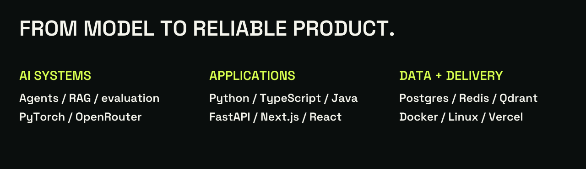
</picture>

Full working stack

**AI:** LLM applications, agent workflows, RAG, hybrid retrieval, evaluation, citations, PyTorch, OpenRouter. 
**Application:** Python, TypeScript, FastAPI, Next.js, React, Java, REST APIs, OAuth, signed webhooks. 
**Data + delivery:** PostgreSQL, pgvector, Redis, Qdrant, Upstash Vector, Prisma, Docker, Linux, Nginx, GitHub Actions, Vercel, VPS.

**SIP Organization** · Project Lead Developer Intern · Jul 2026–Present 
**micro1** · AI Engineer Intern · Aug 2025–Jul 2026 
**Independent AI / ML Developer** · 2025–Present

Experience, education & supplied credential

- **SIP Organization:** AI-powered WhatsApp onboarding, conversational workflows, backend integrations and service delivery.
- **micro1:** worker orchestration and modular cell components for a self-adaptive AI architecture.
- **Independent development:** applied LLM products, automation, APIs and training/inference workflows.

**B.Sc. Computer Science**, Scaler School of Technology with BITS Pilani · Aug 2024–Sep 2028.

Certified Freelance AI / Machine Learning Developer · micro1 · March 11, 2026. [View the supplied certificate](https://aman-kumar-ai-portfolio.vercel.app/assets/micro1-certification.jpg).

Public build activity


Generated daily from public GitHub data. Activity is context, not a substitute for implementation and decisions.

---

**Have a role or a hard engineering problem?** [Email Aman →](mailto:amankumr3254u@gmail.com) 
Open to AI engineering, full-stack roles, internships and contract builds. Bengaluru · any work mode.

[**Portfolio**](https://aman-kumar-ai-portfolio.vercel.app) · [**One-page ATS résumé · PDF**](https://aman-kumar-ai-portfolio.vercel.app/profile/aman-kumar-resume.pdf) · [**LinkedIn**](https://www.linkedin.com/in/aman-kumar-494601329)

[Static header](./assets/identity-signal-still.png) · [Static mobile header](./assets/identity-signal-mobile-still.png) · [Static project films](./PROFILE_EVIDENCE.md#project-showcase-films) · [Evidence & provenance](./PROFILE_EVIDENCE.md). All project films are illustrative source explanations. Account avatars are unchanged.

## The build trace.

<strong>Contribution Loom · collapse to hide motion</strong>

<picture>
  <source media="(max-width: 640px) and (prefers-reduced-motion: reduce)" srcset="./assets/contribution-loom-mobile-still.svg">
  <source media="(max-width: 640px)" srcset="./assets/contribution-loom-mobile.svg">
  <source media="(prefers-reduced-motion: reduce)" srcset="./assets/contribution-loom-still.svg">
  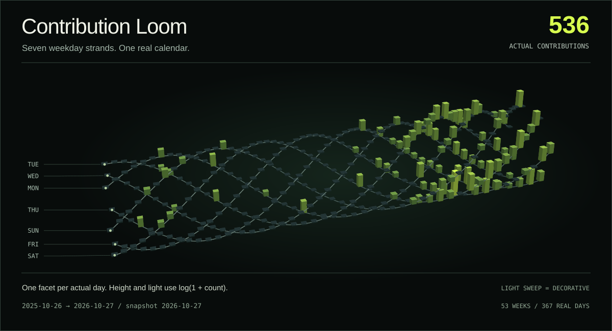
</picture>

A real calendar, woven into seven weekday strands. Facet height follows daily activity; the traveling light is decorative. [Still artwork](./assets/contribution-loom-still.svg) · [Daily data](./assets/contribution-data.json) · [Original renderer](./scripts/render_contribution_loom.mjs)

<strong>Optional · let the contribution snake traverse the same calendar</strong>

<picture>
  <source media="(prefers-reduced-motion: reduce)" srcset="./assets/contribution-calendar.svg">
  
</picture>

<strong>Optional · raise the same year into a 3D contribution skyline</strong>

<picture>
  <source media="(prefers-reduced-motion: reduce)" srcset="./assets/contribution-skyline-still.svg">
  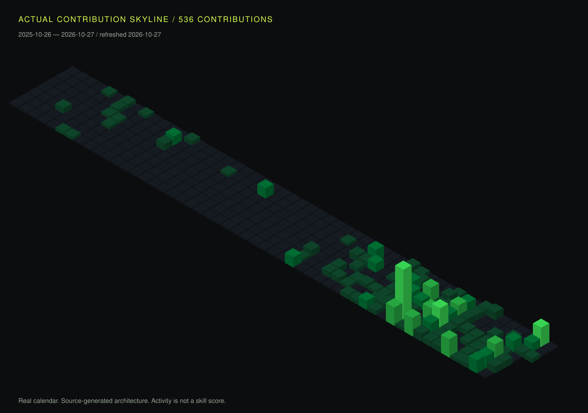
</picture>

Real calendar data, refreshed daily. [Static calendar](./assets/contribution-calendar.svg) · [Snake generator](https://github.com/Platane/snk) · [3D generator](https://github.com/yoshi389111/github-profile-3d-contrib) · [Generation and provenance](./PROFILE_EVIDENCE.md#contribution-instruments). The Contribution Loom is original profile artwork. GitHub's native contribution grid remains GitHub-controlled.
